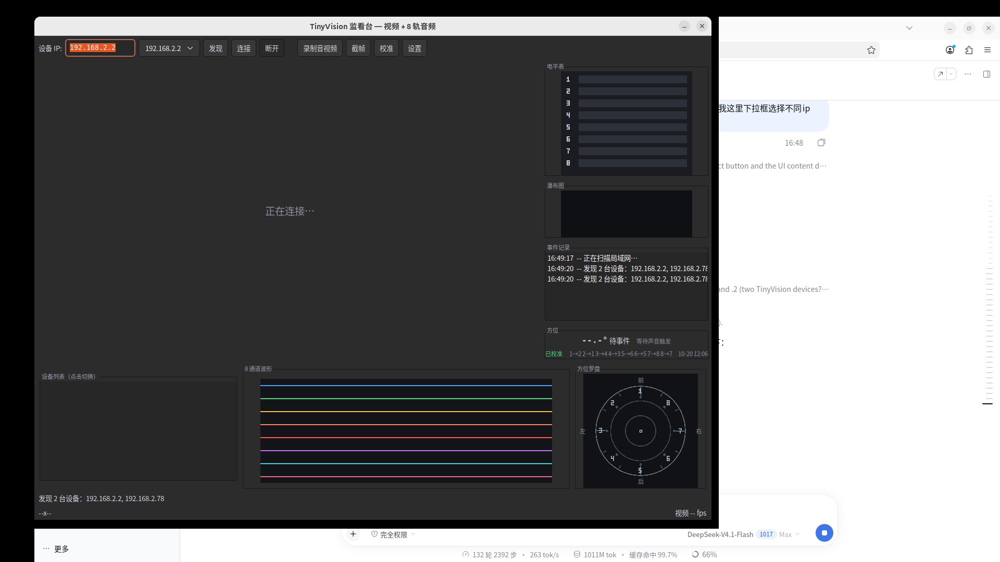

# VA Capture

TinyVision V851se 设备的**音视频监看台**：实时预览摄像头画面与 8 通道麦克风阵列，
内置声源定位（方位角）、事件触发检测，并支持多设备管理与独立录制。



## 功能

- **实时视频**：1080p H.264 硬解（VAAPI）/ 软解自动选择，UDP/TCP 传输可切换
- **8 通道音频**：8×48kHz 16bit PCM，实时电平表、波形、瀑布图
- **声源定位**：SRP-PHAT / MUSIC / MVDR 三种算法，4 麦克风对/28 对 GCC-PHAT
  - 单声源精度约 1.4°，双声源分辨率约 34°（宽带）
  - 方位罗盘 + 历史轨迹 + 置信度
- **事件触发**：按 300–3000Hz 能量突变检测猪咳/狗吠等瞬态事件，触发才定位
- **多设备管理**：自动发现局域网设备、下拉框/列表切换、每台独立状态与录制
- **录制**：视频 + 8 轨音频同步录制，按小时分段，音频 FLAC 无损压缩
- **拍照 / 校准**：原始分辨率截图，阵列角度自动校准

## 安装

### 方式一：.deb 包（推荐）

```bash
sudo apt install ./va-capture_1.0.0_all.deb
```

依赖会自动安装：`python3-gi`、`gir1.2-gtk-3.0`、`python3-numpy`、`ffmpeg`。

安装后从应用菜单启动「VA Capture」，或命令行：

```bash
va-capture 192.168.2.10      # 指定设备 IP（可省略）
```

### 方式二：从源码运行

```bash
sudo apt install python3-gi gir1.2-gtk-3.0 python3-numpy ffmpeg
./bin/va-capture 192.168.2.10
```

若系统 Python 缺少 numpy，启动器会自动回退到开发用的 venv
（可用 `VA_CAPTURE_PYTHON=/path/to/python` 指定）。

## 使用

1. 启动后窗口立即出现，1 秒后自动扫描局域网
2. 顶部下拉框选择设备 → 点「连接」
3. 左下列表显示所有已连接设备及其状态（已连接 / 录制中）
4. 点「录制音视频」开始录制当前设备，切到其他设备再点录制可同时录制多台

### 键盘与交互

| 操作 | 说明 |
|---|---|
| 点击列表行 | 切换显示该设备（不自动连接） |
| 点「连接」 | 连接当前 IP，开始接收 |
| 点「截帧」 | 保存原始分辨率截图 |
| 点「校准」 | 引导式阵列角度校准 |

## 数据目录

录制默认保存在 `~/VA Capture/recordings/dev_<IP>/<时间戳>/`：

```
seg_000.mp4   seg_000.flac
seg_001.mp4   seg_001.flac
...
```

容量估算：约 **6.2 GB/小时**（视频 10.7Mbps + FLAC 音频），可在设置里调整。

## 配置

设置保存在 `~/.config/va-capture/settings.json`，包括：

- 传输协议（udp/tcp）、定位算法、事件灵敏度、定位模式
- 视频解码方式、显示尺寸、电平下限、角度偏移
- 录制分段时长、总时长、音频编码（FLAC/WAV）、保存路径

## 设备端要求

设备需运行 TinyVision 固件并启动两个服务：

| 服务 | 地址 | 说明 |
|---|---|---|
| `tinyvision-ipc` | `rtsp://<ip>/live` | 1080p H.264 视频 |
| `rtsp-av` | `rtsp://<ip>:8554/live` | 8 轨 L16 48kHz 音频 |

固件改动见 [tinyvision-sdk-tracker](https://github.com/Xpg74138/tinyvision-sdk-tracker)。

## 故障排查

| 现象 | 原因/处理 |
|---|---|
| 扫不到设备 | 设备要同时开放 554 和 8554 端口 |
| 花屏 | 改用 TCP 传输（设置 → 传输协议） |
| 硬解不可用 | 需 `render` 组权限；日志会记录探测结果 |
| 音频不刷新 | 设备端 `rtsp-av` 需支持多客户端（见 SDK 补丁） |
| 定位不准 | 先跑一次「校准」；窄带声源建议换 MUSIC/MVDR |

## 许可证

MIT
