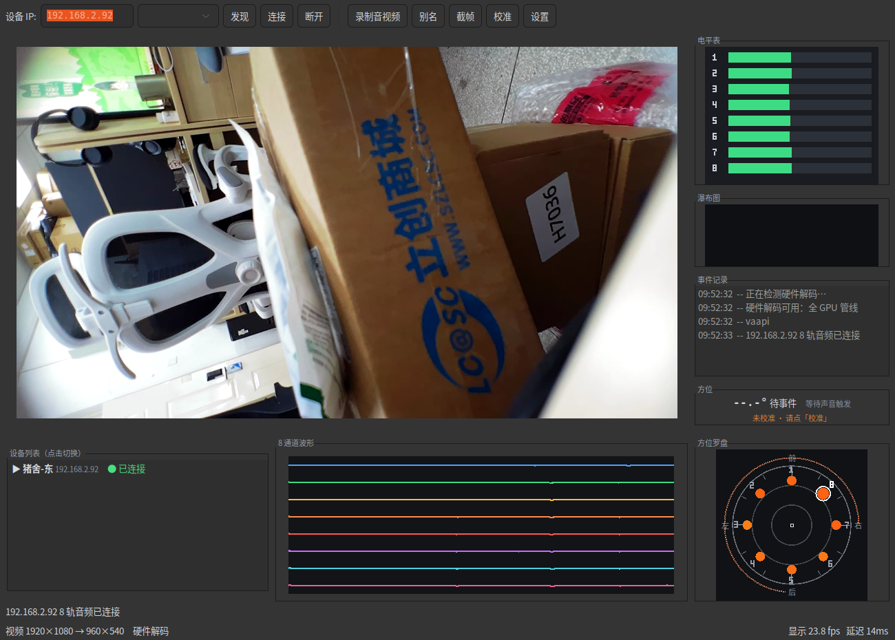

# 八通道声源定位视频监控系统 —— 阶段性汇报

**日期**：2026-11-01　　**版本**：固件 `fw-20261028-fix` / 上位机 `v1.0.31`

---

## 一、项目概述

自研边缘采集设备（Allwinner V851se + 8 麦克风 PDM 阵列）通过以太网直连 PC，
PC 端应用负责实时监看、声源定位与录像存档。

**核心目标与达成情况：**

| 目标 | 状态 |
|---|---|
| 即插即用（插网线自动分配地址） | ✅ 已实现（设备内置 DHCP 服务 + 看门狗自愈） |
| 1080p30 实时视频 | ✅ 已实现 |
| 8 路独立音频（供声源定位） | ✅ 已实现，8 路全部独立传输 |
| 长时间稳定录制 | ✅ 单路连续 16 小时 03 分无中断 |
| 录像体积可控 | ✅ 从 6.1 GB/小时降到 2.8 GB/小时（省 54%） |

### 界面一览（实测）



*界面分区：左上视频（1080p30 硬解显示）、右上 8 路电平表 / 瀑布图 / 事件记录 / 方位、
下方设备列表 / 8 通道波形 / 方位罗盘。底部状态栏显示分辨率和端到端延迟（图中 14 ms）。*

---

## 二、系统架构

### 2.1 硬件组成

| 部件 | 型号 / 规格 | 说明 |
|---|---|---|
| 主控 SoC | Allwinner V851se | Cortex-A7 + RISC-V 协处理器，内置视频编码器 |
| 内存 | 51 MB（MemTotal 51228 kB） | 资源受限，是主要设计约束 |
| 存储 | SD 卡，squashfs 根文件系统 + overlayfs | 固件只读，运行数据写 UDISK 分区 |
| 网络 | 100M 以太网 | 视频 + 音频共用，实测占用约 12 Mbps |
| 摄像头 | GC2053，1080p30 | 硬件 H.264 编码，约 10.5 Mbps |
| 麦克风阵列 | 8 × MEMS PDM（MSM261DDB019） | 4 组立体声对，共用时钟与 4 条数据线 |
| 音频 ADC | TLV320ADC5140 | PDM → I2S，8 通道 |
| 阵列接口 | 16 针 0.5mm FPC 排线 | 时钟 3.072 MHz、4 路数据、3.3V 供电 |

### 2.2 设备端软件（固件）

基于官方 V853 SDK 移植，Tina Linux 4.9.191，musl。

| 服务 | 职责 |
|---|---|
| `tinyvision-ipc` | 视频采集 + H.264 硬编 + RTSP（端口 554） |
| `rtsp-av`（自研） | 8 路音频采集 + RTSP（端口 8554），支持多客户端 |
| `S50eth0static` | MAC 固化与地址派生（重启不变） |
| `S51eth0dhcp` | 内置 DHCP 服务器，电脑插上即自动获得地址 |
| `S97tvlogd`（自研） | 日志采集（设备/内核/视频），30 秒采样、5 分钟滚动 |
| `S02overlay-clean`（自研） | overlay 自愈：自动清理遮蔽新固件的旧脚本 |

### 2.3 PC 端应用

Python 3 + GTK3，单文件部署（.deb），支持多设备管理。

| 模块 | 功能 |
|---|---|
| 视频 | 解码显示、多设备切换、断线自动重连 |
| 音频 | 8 路独立电平表、8 通道波形、瀑布图 |
| 声源定位 | SRP-PHAT 算法，实时方位角 + 置信度 + 轨迹罗盘 |
| 音频校准 | 8 通道自动顺序校准（解决接线顺序不一致） |
| 录制 | 硬件 H.265 + FLAC 无损，1 小时分段，文件名带时间戳 |
| 设备管理 | 别名、多设备独立录制、录制时长显示 |
| 安全保护 | 磁盘空间预检 + 自动停录、单实例、崩溃自愈 |

---

## 三、关键指标实测数据

### 3.1 视频

| 指标 | 实测值 |
|---|---|
| 分辨率 / 帧率 | 1920×1080 / 30 fps |
| 编码格式 | H.264 High@5.1（设备端） |
| 输出码率 | 10.44 Mbps |
| 显示延迟 | 10~40 ms（采集到显示） |

### 3.2 音频

| 指标 | 实测值 |
|---|---|
| 通道数 | 8 路独立（非混音） |
| 采样率 / 位深 | 48 kHz / 16 bit |
| 单路电平一致性 | 最大偏差 **0.9 dB**（-34.2 ~ -33.3 dB） |
| 声道顺序 | 校准后 1→2→3→4→5→6→7→8 顺序正确 |
| 编码（录像） | FLAC 无损，8 声道 |

### 3.3 资源占用

| 项目 | 数值 |
|---|---|
| 设备端可用内存 | 6.6 MB / 51 MB（新固件预计 7.2 MB） |
| 设备端温度 | 59.3 °C |
| 设备端内核告警 | 0 条（连续运行 12 分钟采样） |
| PC 端 CPU（单路录制） | 0.68 ~ 1.03 核（12 核机器 ≈ 8%） |
| PC 端内存（录制中） | 约 110 MB |

### 3.4 录像体积对比（单台设备）

| 录制模式 | 体积/小时 | 8 小时 | 说明 |
|---|---|---|---|
| 无损复制 + FLAC（改造前） | 6.1 GB | 49 GB | 与设备输出逐比特一致 |
| **硬件 H.265 4Mbps + FLAC（当前）** | **2.8 ~ 3.3 GB** | **23 ~ 26 GB** | 画质 SSIM 0.981 |
| 硬件 H.265 2Mbps + FLAC | 2.5 GB | 20 GB | 更省空间 |

---

## 四、稳定性验证

| 测试 | 时长 | 结果 |
|---|---|---|
| **单路连续录制** | **16 小时 03 分** | ✅ 15 个分段（每段精确 3600.0 秒），共 45 GB，无中断 |
| 双路同时录制 | 8 小时 45 分 | ✅ 两路各 26 GB，由磁盘保护正常停止 |
| 断线重连 | 多轮 | ✅ 退避重连，不刷屏、不崩溃 |
| 长时间运行 | 6.5 小时 | ✅ 曾被系统 OOM 连带杀死，已通过独立 cgroup 解决 |

**长时间录制输出示例**（16 小时测试）：

```
20261028_181817_000.mp4   hevc  1920x1080  4.0 Mbps  3600.0 s
20261028_181817_000.flac  flac  48000 Hz   8 声道
...
共 30 个文件（15 段视频 + 15 段音频），45 GB
```

---

## 五、已解决的关键技术问题

| # | 问题现象 | 根因 | 解决方案 |
|---|---|---|---|
| 1 | 设备运行数小时后死机、重启失效 | 内存被旧固件脚本耗尽（35 MB → 1 MB） | overlay 自愈机制 + 精简常驻进程，可用内存 4 → 6.6 MB |
| 2 | 录制一段时间后界面卡死、关不掉 | ffmpeg 内存以 20 MB/分钟线性泄漏 | 拆分为"视频进程 + 音频进程"，两路均 0 增长 |
| 3 | 最后一段录像无法播放 | 强杀进程导致 mp4 索引未写入 | 改为优雅停止（SIGINT + 读完管道） |
| 4 | 磁盘满后"只有声音没有画面" | 仅视频进程失败退出 | 空间不足时音视频一起停 + 开始前预检 |
| 5 | 音频重连日志刷屏，无法分辨设备 | 退避计数被提前清零 | 收到首块数据才算连上，消息带设备地址 |
| 6 | PC 端应用被系统 OOM 连带杀死 | 与终端共享 cgroup，页缓存涨到 13 GB | 改为独立 systemd 服务 + 2 GB cgroup 上限 |
| 7 | 录像体积过大（6.1 GB/小时） | 设备端固定 10.5 Mbps | 启用 Intel 硬件 H.265 编码，降至 2.8 GB/小时 |
| 8 | 设备日志时间戳无意义（1970 年） | 板子无 RTC、无外网 | RTSP `SET_PARAMETER` 通道由 PC 下发时间 |
| 9 | 排线发热 | FPC 排线插反，3.3V 对地短路 | 定位并纠正（详见硬件问题跟踪） |

---

## 六、当前限制

| 限制 | 影响 | 现状 |
|---|---|---|
| 设备端视频程序为预编译，无源码 | 编码格式/码率固定为 H.264 10.5 Mbps | PC 端转码规避（有 1 次重编码损失，SSIM 0.981） |
| 视频 RTSP 仅支持单客户端 | 显示 + 录制不能同时开两路 | 已用"复用显示流"规避，全程只占 1 路客户端 |
| 设备无 RTC | 日志时间不可信 | 已用 PC 校时解决 |
| 麦克风供电电压待确认 | 器件标称 1.8V，板上为 3.3V | 待查数据手册确认，长期可靠性风险 |
| 无录像自动清理 | 录满后需人工清理 | 已有空间保护自动停录，尚无环形覆盖 |

---

## 七、后续计划

| 优先级 | 事项 | 说明 |
|---|---|---|
| 高 | 录像容量上限 + 自动清理旧录像 | 实现 7×24 连续录制，无需人工干预 |
| 高 | 麦克风供电电压确认与整改 | 硬件可靠性，影响长期一致性 |
| 中 | 自研设备端视频推流（H.265 直出） | 可免去 PC 重编码，带宽减半，需重写视频管线 |
| 中 | 声源定位精度标定 | 当前提供方位角 + 置信度，缺定量精度指标 |
| 低 | 设备别名按 MAC 绑定 | 换 IP 后别名不丢失 |

---

## 八、交付物

| 交付物 | 地址 |
|---|---|
| 上位机源码与安装包 | `github.com/Xpg74138/va-capture`（公开发布，提供 .deb） |
| 固件源码补丁与镜像 | `github.com/Xpg74138/tinyvision-sdk-tracker`（私有，含 33 个补丁） |
| 固件版本 | `fw-20261028-fix` |
| 上位机版本 | `v1.0.31` |

**上位机安装方式**：`sudo apt install ./va-capture_1.0.31_all.deb`，装完从应用菜单打开即可。
